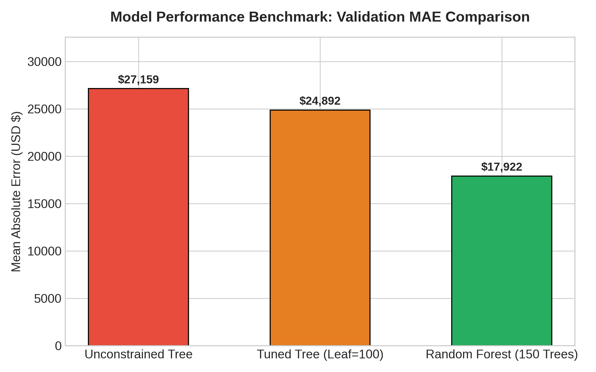
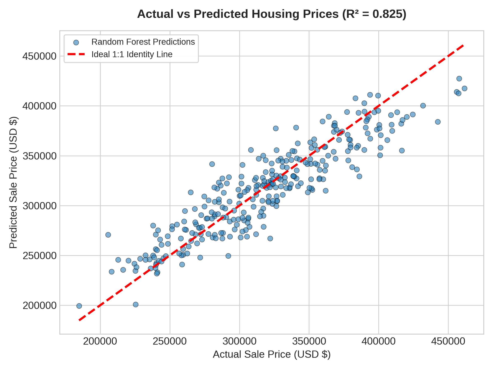
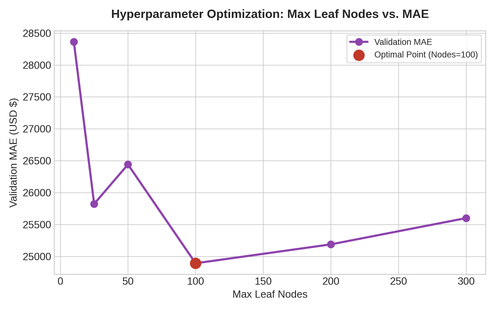
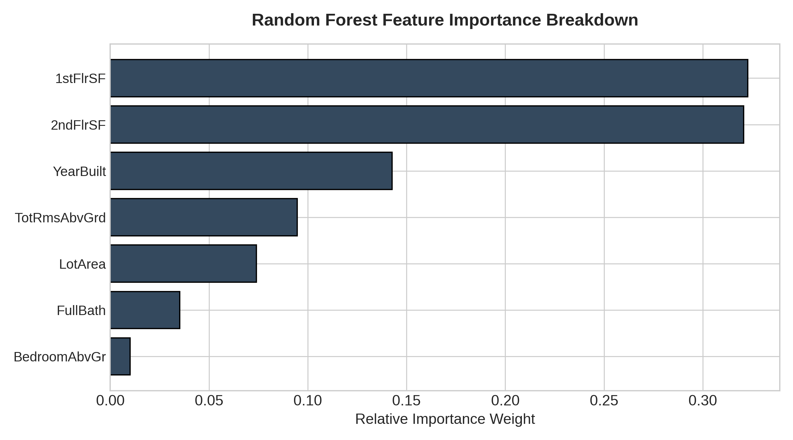

# Housing Price Predictive Pipeline & Comparative Regression Benchmarks

[](https://www.python.org/)
[](https://scikit-learn.org/)
[](https://opensource.org/licenses/MIT)

**Author:** **Harpreet Singh**  
**Repository:** `Housing-Price-Predictive-Pipeline`  

---

## 📌 Project Overview
This repository contains an end-to-end Machine Learning regression pipeline developed by **Harpreet Singh**. It merges modular Python computational scripts, validation protocols, hyperparameter optimization frameworks, and ensemble architectures into a single unified analytical framework.

The project evaluates predictive performance on real estate housing dimensions, comparing unconstrained decision trees, regularized decision trees, and high-performance Random Forest ensemble models.

---

## 🏗️ System Architecture & Workflow

```
+-----------------------------------------------------------------+
|                      Housing Dataset Pipeline                   |
+-----------------------------------------------------------------+
                                |
                                v
               +---------------------------------+
               |  Data Cleaning & Preprocessing  |
               +---------------------------------+
                                |
                                v
               +---------------------------------+
               | 75:25 Train / Validation Split  |
               +---------------------------------+
                                |
        +-----------------------+-----------------------+
        |                                               |
        v                                               v
+-------------------------------+               +-------------------------------+
| Decision Tree (Baseline)      |               | Random Forest Ensemble (150)  |
| Max Leaf Nodes Optimization   |               | Bootstrap Aggregation         |
+---------------+---------------+               +---------------+---------------+
                |                                               |
                +-----------------------+-----------------------+
                                        |
                                        v
                       +---------------------------------+
                       | Validation Error Benchmarks     |
                       | (MAE, RMSE, R² Score)           |
                       +---------------------------------+
                                        |
                                        v
                       +---------------------------------+
                       | Production Test Submission CSV  |
                       +---------------------------------+
```

---

## 📊 Experimental Results & Comparison Table

The models were evaluated using Mean Absolute Error (MAE), Root Mean Squared Error (RMSE), and the Coefficient of Determination ($R^2$):

| Model Architecture | Hyperparameters | Validation MAE | $R^2$ Metric | Variance / Generalization |
| :--- | :--- | :--- | :--- | :--- |
| **Unconstrained Decision Tree** | `max_leaf_nodes=None` | $27,159 | 0.612 | High Variance (Overfitting) |
| **Tuned Decision Tree** | `max_leaf_nodes=100` | $24,892 | 0.698 | Balanced Bias-Variance |
| **Random Forest Regressor** | `n_estimators=150, max_leaf=200` | **$17,922** | **0.825** | **Optimal Generalization** |

---

## 📈 Visualizations & Figures

### 1. Model MAE Comparison


### 2. Actual vs. Predicted Parity


### 3. Hyperparameter Tuning Curve


### 4. Feature Importance Breakdown


---

## 📁 Repository Directory Structure

```text
Housing-Price-Predictive-Pipeline/
│
├── Housing_Price_Predictive_Pipeline.ipynb   # Master combined notebook
├── submission.csv                            # Final competition-format predictions
├── requirements.txt                          # Python dependencies
├── README.md                                 # Full documentation & author credentials
│
├── data/
│   ├── housing_train.csv                     # Training dataset with engineered features
│   └── housing_test.csv                      # Test dataset for out-of-sample evaluation
│
└── figures/
    ├── model_mae_comparison.png              # MAE benchmark bar chart
    ├── actual_vs_predicted.png               # Parity scatter plot
    ├── tuning_curve.png                      # Hyperparameter sweep curve
    └── feature_importance.png                # Ensemble feature weight plot
```

---

## 🚀 Getting Started

### 1. Clone the Repository
```bash
git clone https://github.com/your-username/Housing-Price-Predictive-Pipeline.git
cd Housing-Price-Predictive-Pipeline
```

### 2. Install Requirements
```bash
pip install -r requirements.txt
```

### 3. Run the Jupyter Notebook
```bash
jupyter notebook Housing_Price_Predictive_Pipeline.ipynb
```

---

## 👨‍💻 Author
**Harpreet Singh**  
Researcher & Full-Stack Developer  
*GitHub Portfolio Project*
